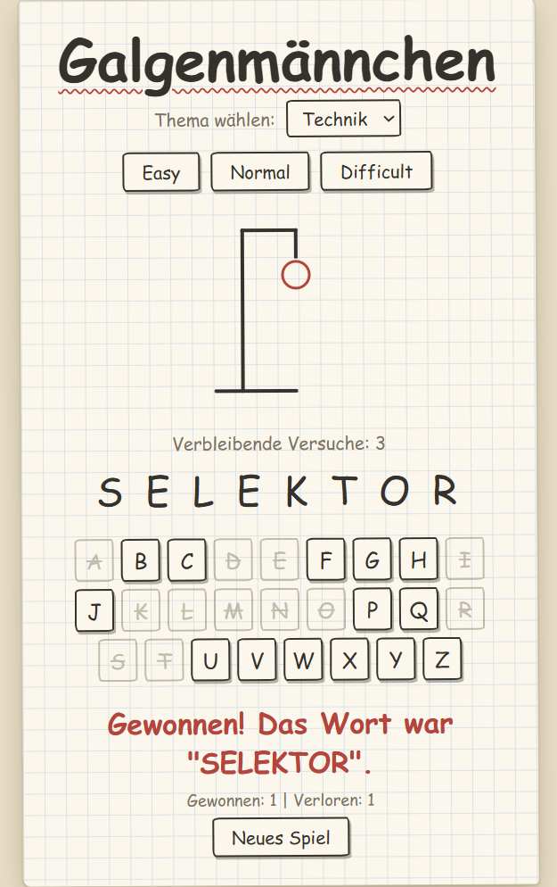

# Hangman (Galgenmännchen)

A browser-based Hangman game built with plain HTML, CSS and JavaScript. The interface and word lists are in German.

This project is part of my retraining as a **Fachinformatiker für Anwendungsentwicklung** (IT specialist in application development). I built it to practise DOM manipulation, event handling and structuring a small project into modules.

<p align="center">

</p>

## Features

- Two word categories: technology and animals
- Three difficulty levels: easy (8 tries), normal (6 tries) and difficult (4 tries)
- Play with the on-screen keyboard or your physical keyboard
- Stick figure drawn step by step in SVG
- Win/loss counter across rounds
- Responsive paper-and-pencil design

## Project structure

```
.
├── index.html
├── script.js
├── style.css
├── words/
│   ├── tech.js
│   └── animals.js
└── fonts/
    ├── PatrickHand-Regular.ttf
    └── Caveat-Bold.ttf
```

## Running the project

The script uses ES modules, which browsers block when a page is opened directly from the file system. Start a local server instead, for example:

- the **Live Server** extension in VS Code, or
- `npx serve` in the project folder

Then open the address shown in the terminal.

## What I practised

- Selecting and updating elements with the DOM API
- Event listeners and event delegation
- Splitting code into ES modules
- State handling for a game (tries, win/loss, reset)
- Layout and styling with CSS (flexbox, custom properties, gradients)

## Credits

- Fonts: [Patrick Hand](https://fonts.google.com/specimen/Patrick+Hand) and [Caveat](https://fonts.google.com/specimen/Caveat) from Google Fonts (SIL Open Font License)